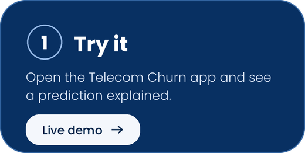
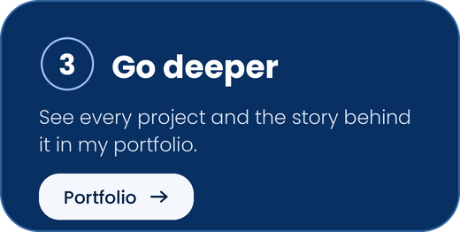
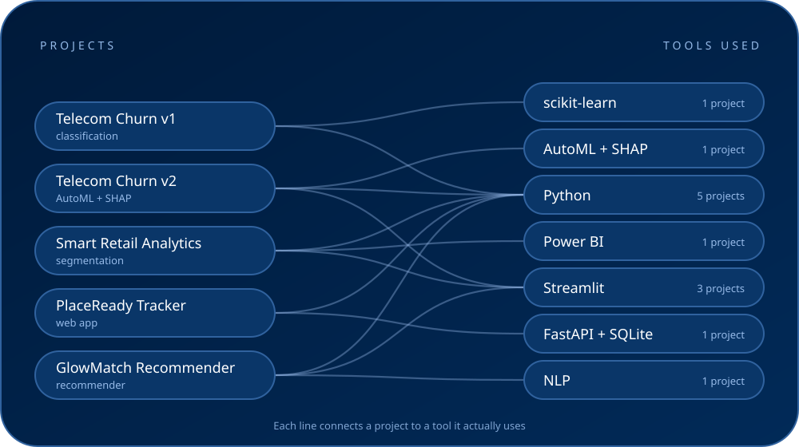
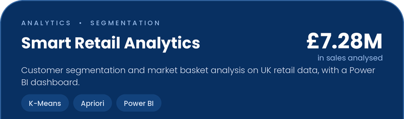
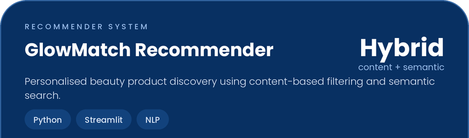
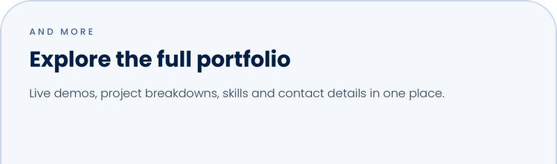

&nbsp;&nbsp;
&nbsp;&nbsp;

## About me

## 60-second tour

No time to read everything? Here is the fast path.

## By the numbers

## Toolkit map

Also comfortable with SQL, Pandas, NumPy, Matplotlib, Jupyter and Git.

## How I build

## Featured projects

  
 

  
 

  
 

> Use the **Live demo** and **Code** buttons inside each card. The demos run on free hosting, so an app can take up to a minute to wake up on the first visit.

 

