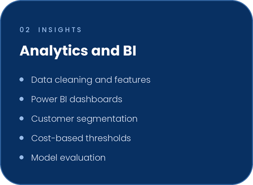
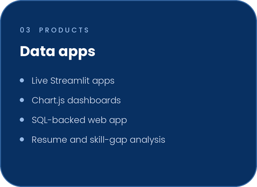
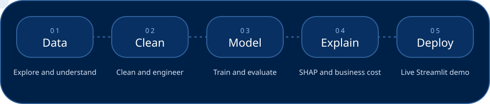
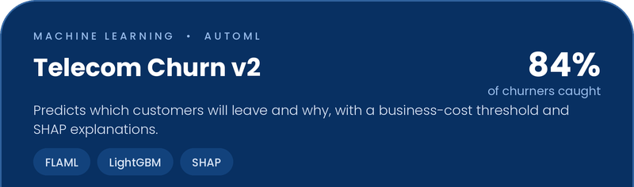
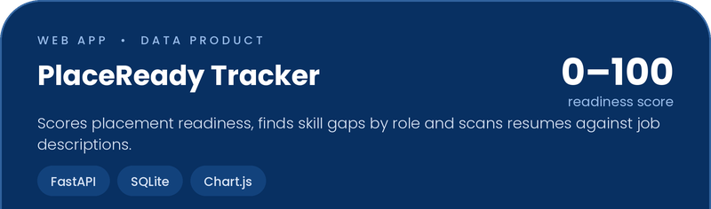
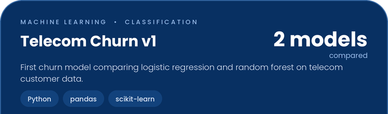

&nbsp;&nbsp;
&nbsp;&nbsp;

## About me

Data is only useful when someone can act on it. I'm a BSc Data Science student who builds machine learning models and analytics dashboards that answer a real question, explain why, and ship as something you can open and try. Every project follows the same rule: a clear problem, a clean method, honest results and a live demo.

## Portfolio

## What I work on

## How I build

## Tech stack

**Languages and data**&nbsp;&nbsp;

**Machine learning**&nbsp;&nbsp;

**Visualisation and apps**&nbsp;&nbsp;

**Tools**&nbsp;&nbsp;

## Featured projects

  
 

  
 

  
 

> Use the **Live demo** and **Code** buttons inside each card. The demos run on free hosting, so an app can take up to a minute to wake up on the first visit.

 

