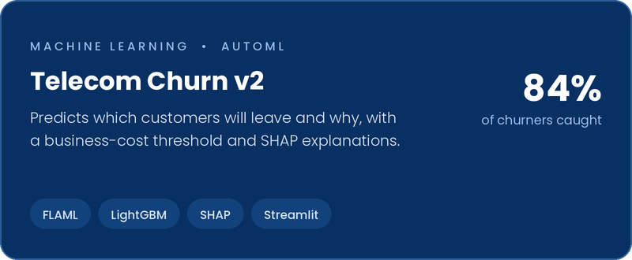
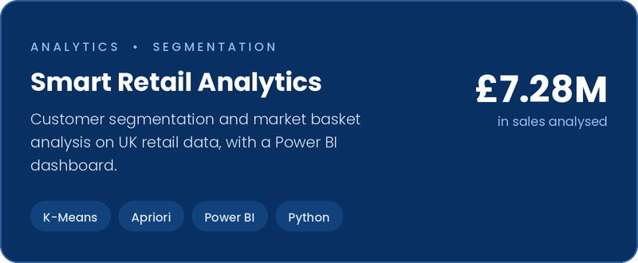
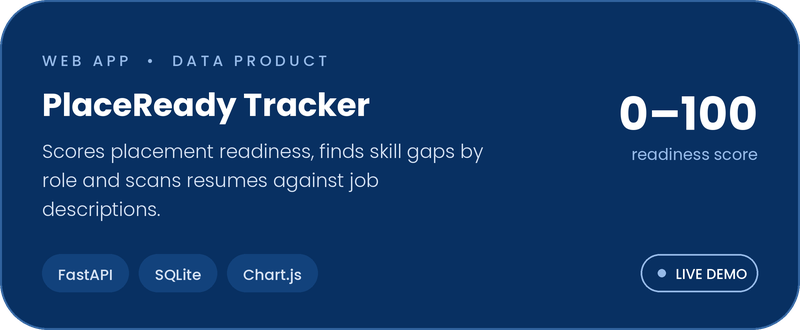
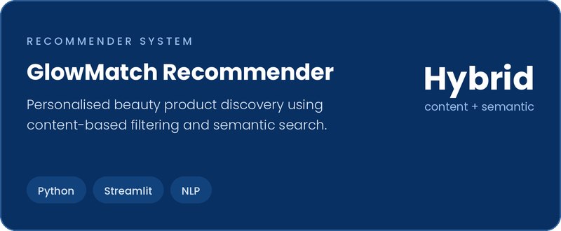
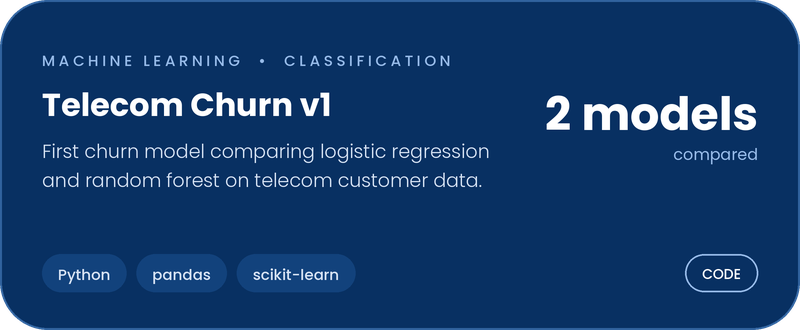
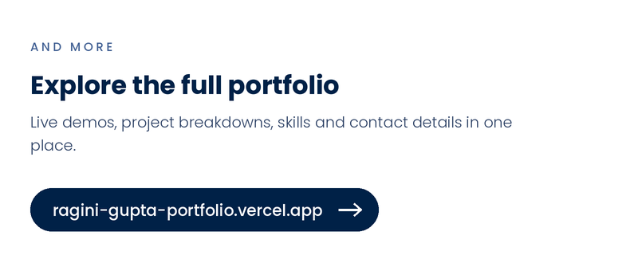

 

---

## About me

I'm a BSc Data Science student who likes turning raw data into decisions people can act on. I build machine learning models and analytics dashboards, and I finish each project with something you can open and try.

- **What I build:** churn prediction, customer segmentation, recommender systems and data-driven web apps
- **What I enjoy:** explainable machine learning, business-focused metrics and clear dashboards
- **How I work:** one clear problem, a clean method, honest results and a live demo

## Portfolio

## What I work on

<table>
<tr>
<td width="33%" valign="top">

**Machine learning**

- Classification: logistic regression, random forest, AutoML
- Clustering with K-Means
- Association rules with Apriori
- Recommender systems
- Explainability with SHAP

</td>
<td width="33%" valign="top">

**Analytics and BI**

- Data cleaning and feature engineering
- Power BI dashboards
- Customer segmentation
- Cost-based decision thresholds
- Model evaluation

</td>
<td width="33%" valign="top">

**Data apps**

- Live Streamlit apps
- Chart.js dashboards
- SQL-backed web app
- Resume and skill-gap analysis

</td>
</tr>
</table>

## Tech stack

**Languages and data**&nbsp;&nbsp;

**Machine learning**&nbsp;&nbsp;

**Visualisation and apps**&nbsp;&nbsp;

**Tools**&nbsp;&nbsp;

## Featured projects

<table>
<tr>
<td width="50%" align="center">

 <a href="https://telecom-churn-prediction-automl.streamlit.app/">Live demo</a> &nbsp;|&nbsp; <a href="https://github.com/RaginiGupta21/Telecom-Churn-Prediction-AutoML">Code</a>
</td>
<td width="50%" align="center">

 <a href="https://smart-retail-analytic.streamlit.app/">Live demo</a> &nbsp;|&nbsp; <a href="https://github.com/RaginiGupta21/smart-retail-analytics">Code</a>
</td>
</tr>
<tr>
<td width="50%" align="center">

 <a href="https://placeready-tracker.onrender.com/">Live demo</a> &nbsp;|&nbsp; <a href="https://github.com/RaginiGupta21/placeready-tracker">Code</a>
</td>
<td width="50%" align="center">

 <a href="https://glowmatch-beautytech-recommender.streamlit.app/">Live demo</a> &nbsp;|&nbsp; <a href="https://github.com/RaginiGupta21/glowmatch-beautytech-recommender">Code</a>
</td>
</tr>
<tr>
<td width="50%" align="center">

 <a href="https://github.com/RaginiGupta21/Telecom-Churn-Prediction">Code</a>
</td>
<td width="50%" align="center">

 <a href="https://ragini-gupta-portfolio.vercel.app/">Visit the portfolio</a>
</td>
</tr>
</table>

> The live demos run on free hosting, so an app can take up to a minute to wake up on the first visit.

 

