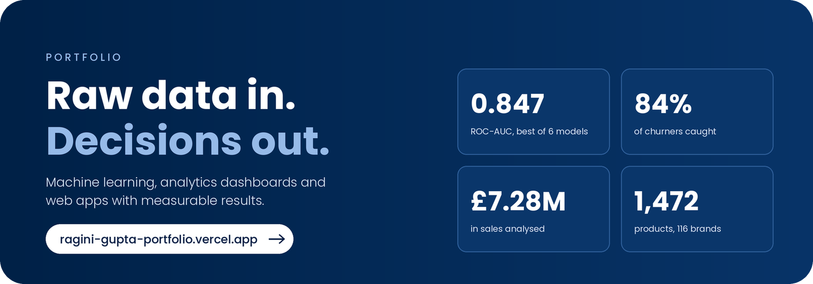
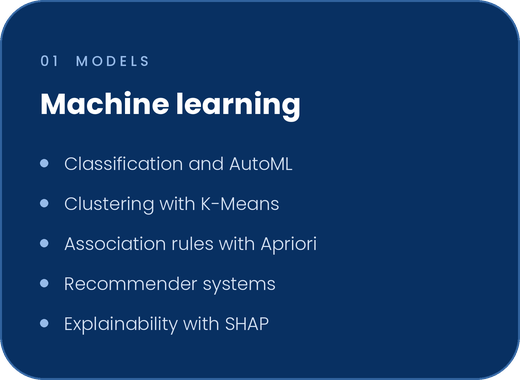

&nbsp;&nbsp;
&nbsp;&nbsp;

## About me

I'm a BSc Data Science student who likes turning raw data into decisions people can act on. I build machine learning models and analytics dashboards, and I finish each project with something you can open and try.

- **What I build:** churn prediction, customer segmentation, recommender systems and data-driven web apps
- **What I enjoy:** explainable machine learning, business-focused metrics and clear dashboards
- **How I work:** one clear problem, a clean method, honest results and a live demo

## Portfolio

## What I work on

## How I build

## Tech stack

**Languages and data**&nbsp;&nbsp;

**Machine learning**&nbsp;&nbsp;

**Visualisation and apps**&nbsp;&nbsp;

**Tools**&nbsp;&nbsp;

## Featured projects

 

 

 

> Click a card with a LIVE DEMO tag to open the app. The demos run on free hosting, so an app can take up to a minute to wake up on the first visit.

 

